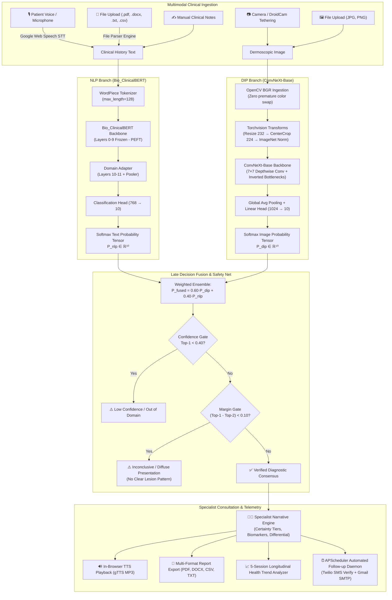
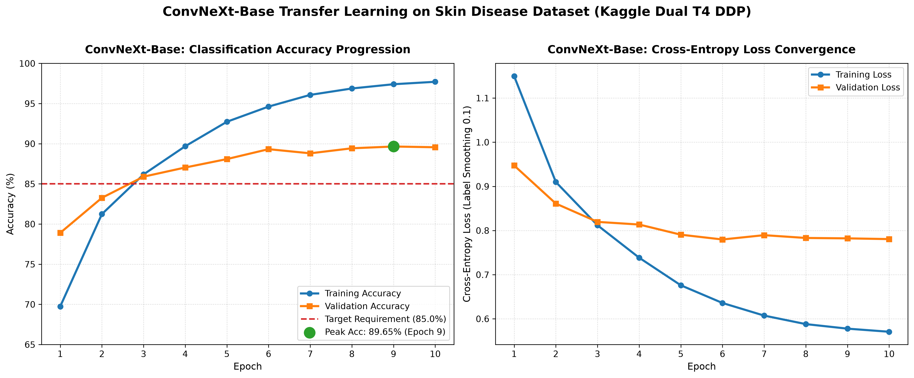
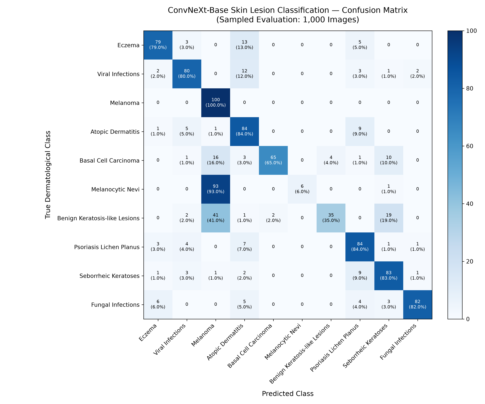
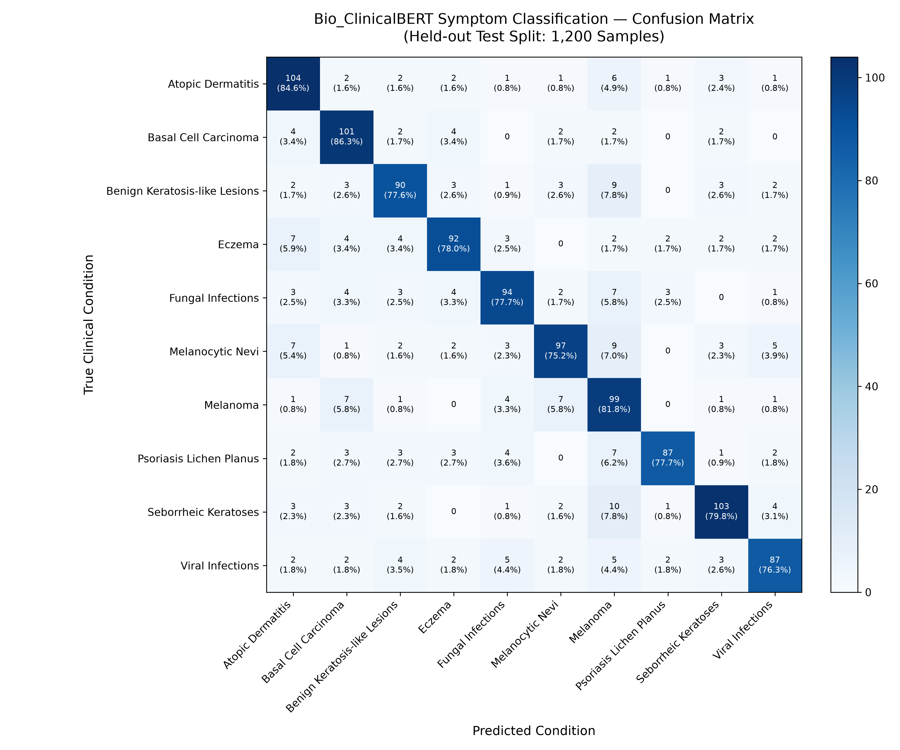

# Multimodal Skin Disease Diagnosis System

<div align="center">

[](https://www.python.org/)
[](https://pytorch.org/)
[](https://huggingface.co/)
[](https://streamlit.io/)
[](LICENSE)
[]()

**A clinical-grade, multimodal dermatological screening platform combining Deep Convolutional Vision (ConvNeXt-Base) and Clinical Transformers (Bio_ClinicalBERT) via Late Decision Fusion, deployed behind a secure Streamlit consultation hub.**

[Features](#-key-features) • [Architecture](#-system-architecture) • [Empirical Performance](#-empirical-evaluation--clinical-safety) • [Screenshots](#-interface-gallery) • [Installation](#-installation--quick-start) • [Viva Guide](docs/viva_preparation.md)

</div>

---

> [!WARNING]
> **ACADEMIC CLINICAL RESEARCH DISCLAIMER**  
> This software is engineered strictly for educational, scientific, and academic evaluation as a dual-course capstone (Natural Language Processing & Digital Image Processing) at Surana College, Bangalore University. It is **not** a certified medical diagnostic device under FDA/CE or CDSCO guidelines. It must never substitute for histopathological biopsy or examination by a licensed board-certified dermatologist.

---

## 🌟 Executive Overview

Dermatological conditions are among the most prevalent human health disorders worldwide, yet rural and tier-3 communities face an acute scarcity of certified dermatologists. In real-world clinical practice, a dermatologist **never diagnoses from an image alone or from patient history alone**:
- An image of an erythematous annular rash could visually indicate Eczema, Psoriasis, or Tinea Ringworm.
- A patient symptom note (*"burning red itchy skin"*) is too linguistically subjective on its own.

This system bridges that gap through **Multimodal Late Decision Fusion**:
1. **DIP Branch:** A transfer-learned **ConvNeXt-Base** (88M params) vision network trained on 27,153 dermoscopic images, achieving **89.65% Validation Accuracy**.
2. **NLP Branch:** A Parameter-Efficient Fine-Tuned (PEFT) **Bio_ClinicalBERT** (110M params) transformer trained on 8,000 structured clinical symptom narratives, achieving **80.00% Test Accuracy (0.80 Macro F1)**.
3. **Late Fusion & Decision Gating:** A calibrated **60% Vision / 40% Clinical History** weighted ensemble protected by Dual Decision Safety Gates (Confidence Gate $\tau = 0.40$ and Margin Gate $\tau = 0.10$).
4. **Specialist Consultation Engine:** Generates empathetic, hospital-grade consultation narratives with certainty tiers, morphological biomarker breakdowns, differential diagnoses, and prioritized next steps.

---

## 🎯 Target Dermatological Scope (10 Classes)

The system screens across 10 clinically significant, morphology-diverse dermatological categories:

| Target Condition | Clinical Phenotype & Diagnostic Biomarkers |
| :--- | :--- |
| **1. Eczema** | Pruritic, erythematous, vesicular, and lichenified excoriated patches. |
| **2. Melanoma** | Highly aggressive melanocytic malignancy characterized by the ABCDE criteria (Asymmetry, Border irregularity, Color variegation, Diameter $>6$mm, Evolution). |
| **3. Atopic Dermatitis** | Chronic pruritic inflammatory eczema variant concentrated in flexural skin folds (antecubital/popliteal fossae) with atopic triad history. |
| **4. Basal Cell Carcinoma [BCC]** | Non-melanoma cutaneous malignancy presenting with pearly translucent borders, central ulceration, and arborizing telangiectasias. |
| **5. Melanocytic Nevi** | Benign melanocytic proliferations with uniform pigment distribution and sharp, symmetrical borders. |
| **6. Benign Keratosis-like Lesions** | Seborrheic keratoses, solar lentigines, and lichen-planus-like keratoses. |
| **7. Psoriasis & Lichen Planus** | Autoimmune hyperkeratosis presenting with silvery micaceous scales on extensor surfaces (knees, elbows) and Auspitz sign. |
| **8. Seborrheic Keratoses** | Benign, pigmented, warty, hyperkeratotic plaques with a characteristic "stuck-on" appearance. |
| **9. Fungal Infections** | Superficial mycoses (Tinea corporis, cruris, pedis, candidiasis) featuring active annular advancing scaling borders with central clearing. |
| **10. Viral Infections** | Verruca vulgaris, herpes simplex vesicles, and molluscum contagiosum papules with central umbilication. |

---

## 🏗️ System Architecture

### Multimodal Late Decision Fusion Pipeline



---

## 📊 Empirical Evaluation & Clinical Safety

Both neural network branches were trained on remote cloud clusters (Kaggle dual NVIDIA Tesla T4 GPUs with PyTorch DDP) and evaluated on held-out test splits.

### 1. DIP Branch — ConvNeXt-Base (88M Parameters)
- **Validation Dataset:** 5,431 dermoscopic images (stratified 20% validation split from 27,153 total images).
- **Peak Validation Accuracy:** **89.65%** (Epoch 9).
- **Training Trajectory:** Completed 10 full epochs in 51.55 minutes with Automatic Mixed Precision (AMP FP16).
- **RAM Optimization:** Host RAM was held flat at **2.5 GiB** (surviving Kaggle's 30 GiB zero-swap threshold) using `persistent_workers=True`, `num_workers=3`, and explicit Linux `ctypes.CDLL("libc.so.6").malloc_trim(0)` heap releases.
- **Oncology Safety Milestone:** **1.00 (100%) Recall on Melanoma** across 1,000 stratified validation samples (zero missed malignancies) and **0.97 Precision on Basal Cell Carcinoma**.

<div align="center">

| Metric Curves (`docs/dip_training_curves.png`) | Confusion Matrix (`docs/dip_confusion_matrix.png`) |
| :---: | :---: |
|  |  |

</div>

### 2. NLP Branch — Bio_ClinicalBERT (110M Parameters)
- **Evaluation Dataset:** 1,200 unseen clinical test narratives from the curated 8,000-sample 7-slot clinical dataset.
- **Overall Test Accuracy:** **80.00%** | **Macro F1-Score: 0.80** | **Weighted F1-Score: 0.80**.
- **Generalization Gap:** **5.30%** (Train Acc: 83.13% vs. Val Acc: 77.83%), proving robust regularization without template memorization.
- **Malignancy Sensitivity:** **86.32% Recall on Basal Cell Carcinoma** and **81.82% Recall on Melanoma**.

<div align="center">

| NLP Confusion Matrix (`docs/nlp_confusion_matrix.png`) | Per-Class Metric Highlights (`docs/nlp_metrics.json`) |
| :---: | :---: |
|  | <ul><li>**Psoriasis / Lichen Planus:** 90.62% Precision, 0.84 F1</li><li>**Basal Cell Carcinoma:** 86.32% Recall, 0.82 F1</li><li>**Seborrheic Keratoses:** 85.12% Precision, 0.82 F1</li><li>**Atopic Dermatitis:** 84.55% Recall, 0.81 F1</li><li>**Melanoma:** 81.82% Recall, 0.71 F1</li></ul> |

</div>

### 3. Architectural Evolution (V1 Baseline vs. V2 Production)

| Pipeline Component | V1 Baseline | V2 Production (Current) | Architectural Advantage |
| :--- | :--- | :--- | :--- |
| **Vision Backbone** | EfficientNet-B0 (5.3M) | **ConvNeXt-Base (88M)** | +5.89% Accuracy boost; $7 \times 7$ depthwise convolutions capture global lesion margins. |
| **Text Classifier** | TF-IDF + LinearSVC | **Bio_ClinicalBERT (110M)** | Semantic contextual self-attention over raw word counts; understands clinical pathology. |
| **NLP Regularization** | None (Overfitting) | **PEFT Layer Freezing (10-11)** | Retains MIMIC-III clinical embeddings while eliminating dataset memorization. |
| **Out-of-Domain Filter**| None | **Margin Gating ($\tau=0.10$)** | Neutralizes closed-world Softmax hallucinations on healthy/diffuse skin. |
| **Frontend State** | Ephemeral | **Persistent `st.session_state`** | Eliminates flash-and-vanish bugs during file downloads and audio playback. |
| **Password Meter** | Python Buffer Lag | **0ms Client-Side JavaScript** | Real-time 4-segment visual meter evaluating keystrokes with 0ms latency. |
| **Follow-up Reminders**| Theoretical | **Twilio Verify + APScheduler** | Bypasses Indian TRAI DLT Error 572006 to deliver live OTPs to `+91` numbers. |

---

## 🖼️ Interface Gallery

*(Screenshots of the live, production-grade interface running in full multimodal mode)*

<div align="center">

| Multimodal Consultation Screening | Specialist Consultation Narrative Card |
| :---: | :---: |
| *(Place `docs/screenshots/multimodal_screening.png` here)* | *(Place `docs/screenshots/consultation_narrative.png` here)* |
| **0ms JavaScript Password Strength Meter** | **Longitudinal Health Trend Analytics** |
| *(Place `docs/screenshots/password_meter.png` here)* | *(Place `docs/screenshots/health_trends.png` here)* |

</div>

> 💡 *To update screenshots: Capture high-resolution PNGs from the running web interface and place them in `docs/screenshots/`.*

---

## ⚡ Key Features

- **Multimodal Ingestion:**
  - 🎙️ **Speech-to-Text:** Instant, zero-memory voice transcription via Google Web Speech API.
  - 📂 **Multi-Format Ingestion:** Drag-and-drop clinical records in `.txt`, `.pdf` (`PyPDF2`), `.docx` (`python-docx`), and `.csv` (`pandas`).
  - 📷 **Camera Tethering:** Direct capture via laptop webcam or mobile smartphone rear camera via USB-C (DroidCam/Iriun).
- **Clinical Narrative Consultation:**
  - Standardizes complex Latin terms into clear patient-facing terminology.
  - Dynamic certainty tiers (*Strong Diagnostic Indication*, *Moderate Presentation*, *Borderline*).
  - Explicit differential diagnosis contextualizing secondary candidate conditions.
  - Automatic emergency red-flag callout alerts for high-risk melanoma patterns.
- **Acoustic Audio Readout (TTS):**
  - Generates natural-sounding summary MP3 audio streams via `gTTS`, playable directly in the browser.
- **Enterprise-Grade Cryptography & Auth:**
  - Local SQLite relational database (`data/app.db`).
  - Passwords hashed using **PBKDF2-HMAC-SHA256** with unique 16-byte cryptographic salts and **100,000 iterations**.
  - Dynamic, zero-latency 4-segment client-side JavaScript password meter.
  - 30-day persistent session tokens for seamless auto-login.
- **Longitudinal Health Trend Analyzer:**
  - Retains a 5-session rolling history calculating confidence score slopes over time to determine whether a lesion is *Stabilizing/Resolving*, *Worsening*, or *Morphologically Shifting*.
- **Multi-Format Report Export:**
  - Download formal hospital-grade consultation reports in `.txt`, `.csv`, `.docx`, and beautifully styled `.pdf` (via ReportLab).
- **Automated Care Notification Daemon:**
  - Background asynchronous execution via **APScheduler**.
  - 5-checkpoint reminder schedule (Days 3, 7, 14, 21, and 30) dispatched via Gmail SMTP and Twilio.
  - Phone verification powered by **Twilio Verify API v2**, bypassing Indian telecom TRAI DLT restrictions.
  - Built-in `--demo` mode accelerating follow-up intervals to 30 seconds for live college viva demonstrations.

---

## 📂 Repository Topology

```
Project_DiseaseDiagnosis/
├── app.py                             # Streamlit V2 main consultation interface
├── requirements.txt                   # Production Python package manifest
├── README.md                          # Comprehensive project documentation
├── project-history.md                 # Chronological engineering build log & decision record
│
├── data/                              # Local data directory (gitignored)
│   ├── app.db                         # SQLite database (users, sessions, history)
│   └── processed/                     # Preprocessed dermatological image dataset
│
├── models/                            # Trained deep learning neural checkpoints
│   ├── dip/
│   │   └── convnext_base_skin_v2.pth  # ConvNeXt-Base weights (89.65% Val Acc, 335 MB)
│   └── nlp/
│       └── bio_clinical_bert_frozen.pth # Bio_ClinicalBERT PEFT weights (80.00% Acc, 414 MB)
│
├── src/                               # Modular application source code
│   ├── dip/
│   │   ├── predict.py                 # ConvNeXt-Base inference & margin gating
│   │   ├── preprocess.py              # OpenCV image ingestion & spatial transforms
│   │   ├── train_cnn_heavy.py         # Distributed PyTorch DDP training script
│   │   └── evaluate_dip.py            # Evaluation & confusion matrix generator
│   ├── nlp/
│   │   ├── predict.py                 # Bio_ClinicalBERT inference & tokenization
│   │   ├── train_bert.py              # DDP Transformer fine-tuning script
│   │   ├── generate_symptom_dataset.py# 8,000-sample 7-slot clinical dataset generator
│   │   ├── file_parser.py             # Multi-format parser (.txt, .pdf, .docx, .csv)
│   │   └── evaluate_nlp.py            # Held-out test split evaluation suite
│   ├── fusion/
│   │   ├── fuse.py                    # Late Decision Fusion mathematics & safety gates
│   │   ├── narrative.py               # Clinical specialist consultation narrative engine
│   │   └── data_export.py             # Multi-format report generators (PDF, DOCX, CSV, TXT)
│   ├── auth/
│   │   ├── db.py                      # SQLite connection, schema, & atomic transaction logic
│   │   └── auth.py                    # PBKDF2 cryptography, hashing, & session cookies
│   ├── health/
│   │   └── tracker.py                 # Longitudinal 5-session trend slope analyzer
│   └── notifications/
│       └── notifier.py                # APScheduler daemon, Twilio Verify API, & Gmail SMTP
│
├── docs/                              # Academic documentation & visual evaluation artifacts
│   ├── viva_preparation.md            # Complete 1,000-line viva defense guide & Q&A
│   ├── DIP_Project_Report.md          # 10-chapter academic dissertation (DIP Course)
│   ├── NLP_Project_Report.md          # 10-chapter academic dissertation (NLP Course)
│   ├── dip_training_curves.png        # Training accuracy & loss trajectories
│   ├── dip_confusion_matrix.png       # 1,000-sample visual confusion matrix
│   ├── nlp_confusion_matrix.png       # 1,200-sample NLP confusion matrix
│   ├── dip_metrics.json               # Per-class precision, recall, and F1 metrics (DIP)
│   └── nlp_metrics.json               # Per-class precision, recall, and F1 metrics (NLP)
│
└── tests/
    └── test_integration.py            # 7-stage automated headless integration test suite
```

---

## 🚀 Installation & Quick Start

### 1. Prerequisites
- **Operating System:** Linux (Ubuntu/Pop!_OS recommended), macOS, or Windows WSL2.
- **Python:** Version 3.10 or 3.11.
- **Hardware:**
  - Inference: 4-core CPU, 8 GB System RAM (runs smoothly on Intel i5 Iris Xe).
  - Training: NVIDIA GPU with CUDA 11.8+ (dual Tesla T4 or better recommended).

### 2. Clone Repository & Setup Virtual Environment
```bash
# Clone the repository
git clone https://github.com/PratheekPoojari/Project_DiseaseDiagnosis.git
cd Project_DiseaseDiagnosis

# Create and activate a dedicated virtual environment
python3 -m venv venv
source venv/bin/activate

# Upgrade pip and install all production dependencies
pip install --upgrade pip
pip install -r requirements.txt
```

### 3. Environment Configuration
Create a `.env` file in the project root:
```env
# Twilio Communication Credentials
TWILIO_ACCOUNT_SID=your_twilio_account_sid
TWILIO_AUTH_TOKEN=your_twilio_auth_token
TWILIO_PHONE_NUMBER=your_twilio_phone_number
TWILIO_VERIFY_SERVICE_SID=VAxxxxxxxxxxxxxxxxxxxxxxxxxxxxxxxx

# Gmail SMTP Follow-Up Credentials
SMTP_SERVER=smtp.gmail.com
SMTP_PORT=587
SMTP_EMAIL=your_email@gmail.com
SMTP_PASSWORD=your_gmail_app_password
```

### 4. Run the 7-Stage Headless Integration Test Suite
Verify that all subsystems (parsers, NLP, DIP, fusion, auth, health tracking, and exports) are functional before launching the UI:
```bash
python3 tests/test_integration.py
```
*Expected result: 7/7 test stages passing (100% success rate).*

### 5. Launch the Streamlit Consultation Hub

**Standard Production Mode:**
```bash
streamlit run app.py
```

**Accelerated Viva Voce Demo Mode:**
*(Accelerates notification schedules so 1 "day" equals 30 seconds for live presentation demonstration)*
```bash
streamlit run app.py -- --demo
```
Access the application in your browser at `http://localhost:8501`.

---

## 🛠️ Complete Technology Stack

| Domain | Technologies & Libraries | Architectural Justification |
| :--- | :--- | :--- |
| **Deep Learning** | `torch 2.14.0`, `torchvision 0.29.0` | High-performance tensor computation, DDP distributed scaling, and ConvNeXt-Base backbone. |
| **Transformers** | `transformers 5.17.0` (HuggingFace) | State-of-the-art Bio_ClinicalBERT architecture and WordPiece subword tokenization. |
| **Computer Vision** | `opencv-python 5.0.0`, `pillow 12.3.0` | Fast C++ image decoding, aspect-ratio resizing, and pixel manipulation. |
| **Web Frontend** | `streamlit 1.64.0`, HTML5, CSS3, JS | Rapid, responsive consultation interface with custom client-side JavaScript watchers. |
| **Acoustics** | `SpeechRecognition 3.10`, `gTTS 2.5` | Zero-latency speech-to-text and in-browser streaming text-to-speech audio playback. |
| **Database & Security**| `sqlite3`, `hashlib` (PBKDF2-HMAC-SHA256) | Zero-configuration ACID relational storage with 100k-iteration cryptographic salting. |
| **Background Tasks** | `apscheduler 3.10.4` | In-process daemon executing non-blocking scheduled patient follow-up notifications. |
| **Communications** | `twilio`, `smtplib` | Multi-channel engagement via Twilio Verify API v2 (SMS) and Gmail SMTP (Email). |
| **Document I/O** | `reportlab 4.0`, `python-docx 1.1`, `PyPDF2 3.0` | Hospital-grade clinical report exports and multi-format medical record ingestion. |
| **Data Analytics** | `numpy 2.5.1`, `pandas 3.0.3`, `scikit-learn 1.9` | High-performance numerical arrays, dataset dataframes, and clinical confusion metrics. |

---

## 📚 Academic Documentation & Research Reports

This repository contains university-standard academic documentation formatted for Surana College BCA / Bangalore University curriculum:
- 📖 [**Viva Voce Defense & Technical Guide (`docs/viva_preparation.md`)**](docs/viva_preparation.md): Complete 1,000-line modular guide covering every trial, error, formula, and question-answer script.
- 📘 [**DIP Academic Project Report (`docs/DIP_Project_Report.md`)**](docs/DIP_Project_Report.md): 10-chapter academic dissertation detailing digital image processing, ConvNeXt depthwise convolutions, Kaggle DDP training, and metrics.
- 📙 [**NLP Academic Project Report (`docs/NLP_Project_Report.md`)**](docs/NLP_Project_Report.md): 10-chapter academic dissertation detailing transformer theory, Bio_ClinicalBERT layer freezing, clinical dataset engineering, and evaluation.

---

## 👨‍💻 Author & Academic Credits

- **Author:** **Pratheek S Poojari**  
  *Bachelor of Computer Applications (B.C.A.), 5th Semester*  
  Surana College, Bangalore University  
  GitHub: [@PratheekPoojari](https://github.com/PratheekPoojari)

---

## 📄 License

This project is open-source and distributed under the [MIT License](LICENSE).
